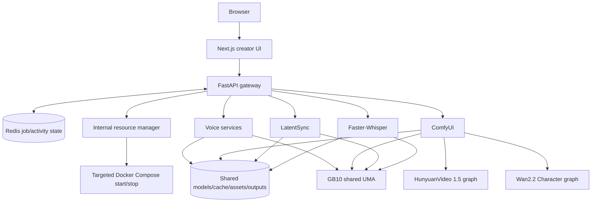
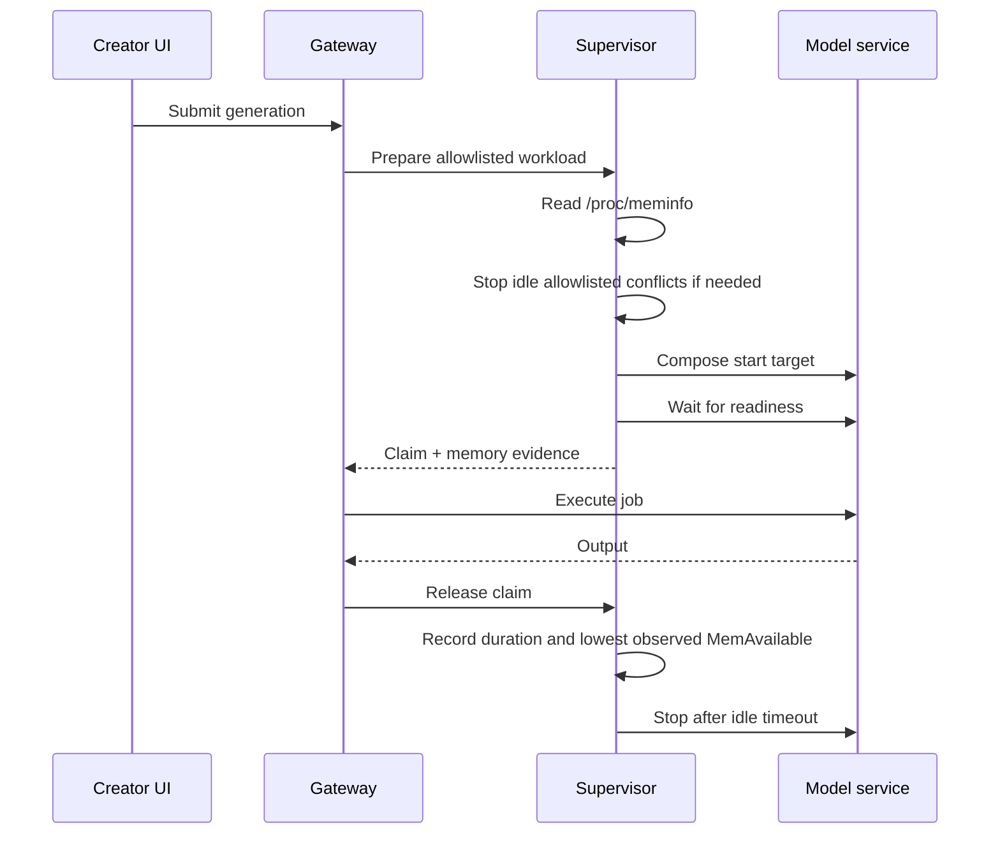

# Architecture

NeonForge is a single-host media studio for DGX Spark. It deliberately uses the existing Next.js, FastAPI, Redis, Docker Compose, and model-service boundaries rather than a general scheduler.

## Workload sequence

The gateway does not have the Docker socket. The supervisor is internal-only and accepts service identifiers from an immutable policy. Its protected set is frontend, gateway, Redis, supervisor, and Whisper. Candidate selection intersects running containers with the allowlist, excludes the requested and claimed services, then tries the largest measured consumers first. No arbitrary kill or host-process path exists.

## Product-to-backend map

| Primary surface | Backend | Lifecycle |
| --- | --- | --- |
| Voiceover | F5/Fish/Miso/Breeze/VoxCPM2 | Voice policies, normally 15-minute warm window |
| Video | HunyuanVideo 1.5 managed ComfyUI template | 40–60 GiB floor by frame count/resolution, 5-minute warm window |
| Character | Wan2.2 Animate managed ComfyUI template | 64 GiB floor for 17-frame preview, 5-minute warm window |
| Avatar | EchoMimicV3-Flash target | Disabled until ARM64 real render passes |
| Lip Sync | LatentSync 1.6 service | 32 GiB cold-start floor, 5-minute warm window |
| System Info | Gateway and supervisor inspection | Always-on control plane |
| Motion Director (feature branch) | Existing external H3 ComfyUI; local validated shot planner | Opt-in reservation only, 90 GiB floor; no lifecycle/reclamation authority |

ComfyUI is intentionally shared by the two managed graph workflows. The gateway supplies the managed workflow identity and bounded frame/resolution inputs. The supervisor applies small measured admission rules, checks warm containers too, and rejects competing active heavy claims.

## Storage

| Host path | Container path | Purpose |
| --- | --- | --- |
| `/srv/ai/models` | `/models` | Explicit checkpoints |
| `/srv/ai/cache/hf` | `/cache/hf` | Shared Hugging Face cache |
| `/srv/ai/outputs` | `/outputs` | Generated media, ComfyUI I/O, history database |
| `/srv/ai/assets` | `/app/data/assets` | Reusable uploads and voice profiles |
| `/srv/ai/logs` | `/logs` | Service logs |

## Failure behavior

- If allowlisted reclamation cannot reach the minimum, the request fails with the required/current memory, what was stopped, and active claims.
- If a model service never becomes ready, the claim is cleaned up and the failure is recorded.
- ComfyUI uses `restart: "no"`; OOM is not hidden by a silent container restart.
- Completed Comfy prompts receive a bounded history-publication grace to avoid queue/history races.
- Service wrappers expose liveness separately from model/readiness state.

This is a small single-machine control plane, not Kubernetes, a DAG engine, a plugin system, or a universal GPU scheduler.

Motion Director adds a persistent shot/job table to the existing SQLite metadata
and reuses uploads, the heavy semaphore, supervisor claims, output storage and
history. `H3_COMFYUI_URL` is blank by default. Once a private route is verified,
the external H3 reservation joins the same claim exclusion rules and guards
other model admissions by inspecting its queue. H3 never becomes a Compose
lifecycle target. Hermes/Grok are interface boundaries only; annotations guide
the prompt until control-video inputs are validated. See [Motion Director's
activation notes](docs/motion-director-v0.1.md).

The continuation adds an opt-in authenticated Unix-socket host adapter. Separate
gateway/supervisor HMAC capabilities expose only planning/resource operations;
provider credentials stay on the host. The installed socket proxy reaches H3
through bridge-only TCP 18189. Managed GPU claims coordinate with the existing
Forge3D lease, preserving/restoring approved idle workloads. Optional Claude
Code Opus checks subscription quota and refuses paid overflow; validated plans
are persisted and never regenerated during inference. Production activation
is gated on real acceptance; see [current preparation and blockers](docs/motion-director-activation.md).
