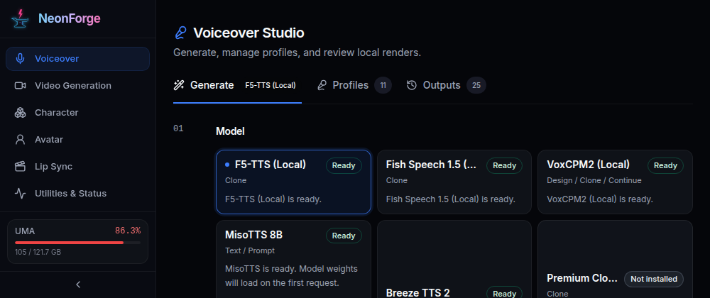
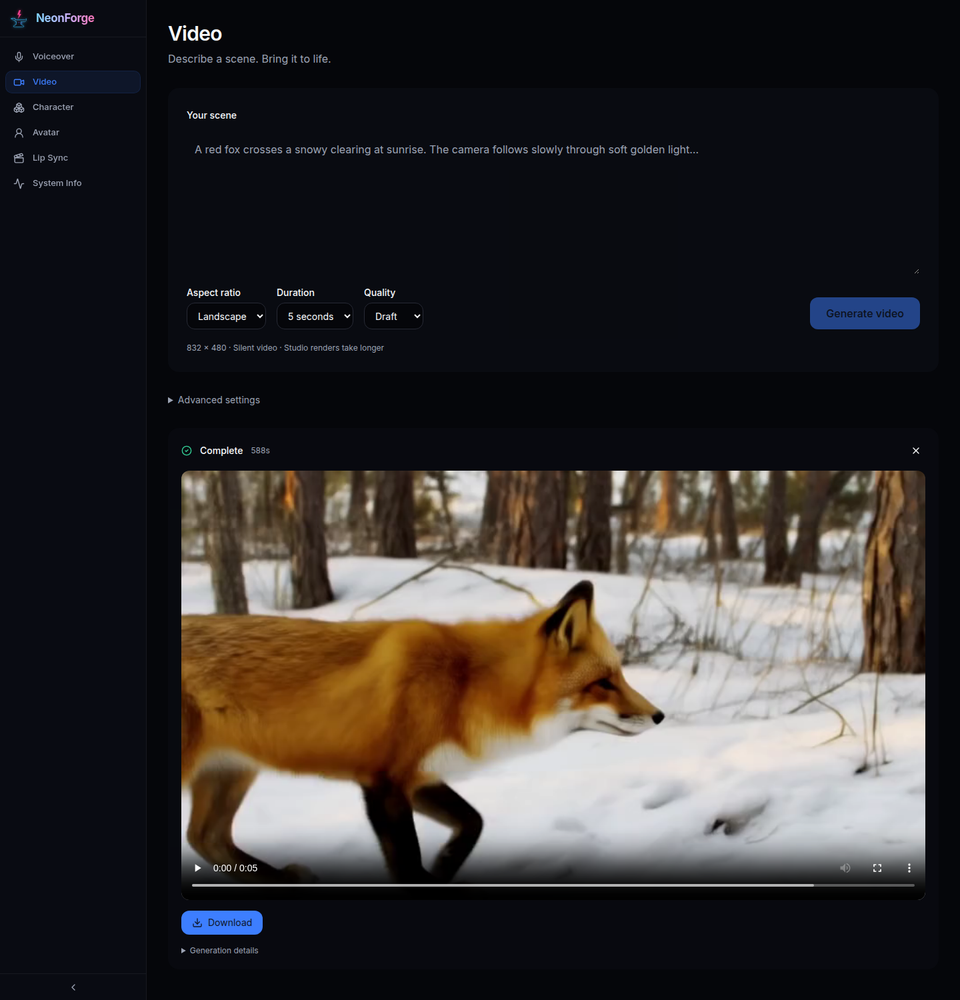
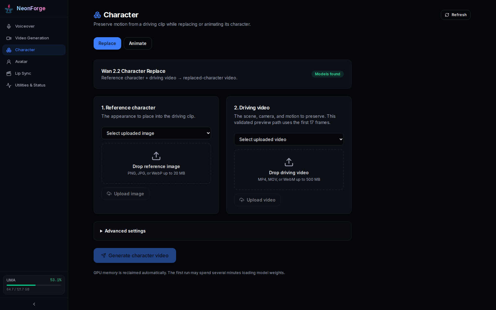
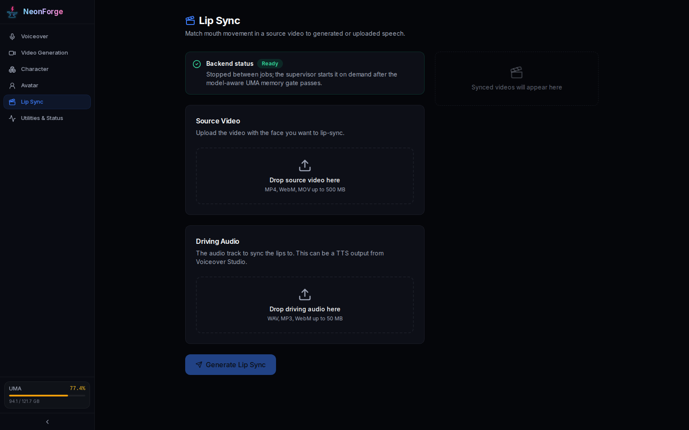
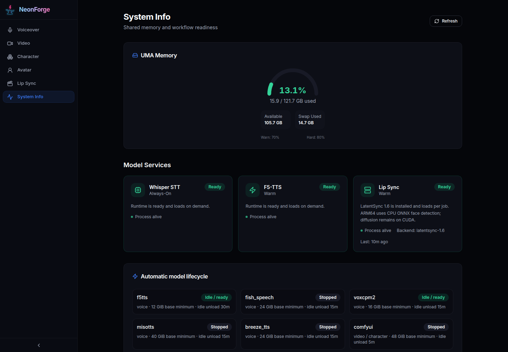

# NeonForge

A local AI creative studio for NVIDIA DGX Spark. Create voices, videos and character performances with automatic model loading and shared-memory management.

[](https://github.com/AlirezaAlampour/neonforge/actions/workflows/ci.yml)




## Workflows

| Workflow | What you create |
| --- | --- |
| Voiceover | Script to speech, voice profiles, voice design, cloning and direction |
| Video | A scene description to a short video |
| Character | Reference character + driving video → a replaced performance; currently a 17-frame preview |
| Avatar | Portrait + speech → talking video; coming soon, generation unavailable |
| Lip Sync | Source video + audio → a synced performance |

Character Animate remains unavailable until a distinct workflow passes local testing. System Info provides service health, model readiness, UMA, swap, claims and memory recovery.

## Why NeonForge

- Local inference with private inputs and outputs.
- Automatic memory preparation, model loading and idle unload.
- One selected backend per media task, replaceable as better options pass validation.
- Built for DGX Spark's shared CPU/GPU memory.
- Consistent creator workspaces and usable outputs.

## Screenshots

| Video | Character |
| --- | --- |
|  |  |

| Lip Sync | System Info |
| --- | --- |
|  |  |

Screenshots are captured from the deployed application. No personal media is included.

## Quick Start

Requires Docker Compose, NVIDIA Container Toolkit, Git and provisioned model files.

```bash
git clone --branch neonforge-v0.2 https://github.com/AlirezaAlampour/neonforge.git
cd neonforge
cp .env.example .env
docker compose config --quiet
docker compose up -d
```

Open the frontend at the configured address (loopback port 3000 by default). Follow [installation](docs/installation.md) to provision storage, images and weights. Models start when needed; the base stack is frontend, gateway, Redis, supervisor and Whisper.

See [Motion reliability and deployment](docs/motion-stabilization.md), [quality findings](docs/motion-quality/STABILITY-QUALITY.md), [modernization proposal](docs/modernization-proposal.md), and [naming proposal](docs/product-identity-proposal.md).

## Models

Voiceover preserves Breeze, F5, Fish, VoxCPM2 and Miso pending capability comparisons. Video uses HunyuanVideo 1.5; Motion Director has a verified local H3 reference-video workflow (see its audit and acceptance notes). Character uses Wan2.2 Animate Replace; Lip Sync uses LatentSync 1.6.

See the dated [model matrix and licenses](docs/models.md), [pivot audit](docs/pivot-audit.md), and [real acceptance evidence](docs/acceptance-v0.2.md). Tests and health endpoints alone do not establish generation support.

## Hardware

Target: NVIDIA DGX Spark, GB10, ARM64 Linux, 128 GB shared UMA. Models share system memory; heavy jobs are serialized and bounded. Large SSD storage is required. Other hosts have not been validated.

## Architecture

Next.js → FastAPI gateway → model services, with Redis jobs and an internal allowlist-only supervisor. ComfyUI implements managed Video and Character templates. Models, caches, profiles and outputs use persistent host storage.

See [architecture](ARCHITECTURE.md) and [troubleshooting](docs/troubleshooting.md).

## Development

```bash
uv lock --check
uv sync --locked --dev
uv run --locked pytest -p no:cacheprovider
uv run --locked --no-sync node frontend/node_modules/typescript/bin/tsc --noEmit -p frontend/tsconfig.json
(cd frontend && uv run --locked --no-sync node node_modules/next/dist/bin/next build --webpack)
```

Commands above use the existing frontend dependencies and verified uv environment; they do not install Node packages. Package changes in this workspace use uv. See [acceptance procedures](ACCEPTANCE_TESTS.md) for actual DGX renders.

## License

No NeonForge source license has been granted in this repository; absent a license, redistribution rights are not implied. Third-party code, checkpoints, voices, reference media and outputs retain their own terms. Review [model licenses](docs/models.md) before commercial use.

Motion Director on the unmerged `motion-director-v0.1` branch now includes real
Claude Pro → Blender 3D preview/revisions → H3 reference-video conditioning, plus
Grok browser export/import. See the [audit and workflow](docs/motion-3d/WORKFLOW.md)
and [measured acceptance](docs/motion-3d/VERIFICATION.md).

The quality follow-up adds separate Opus scene/H3 plans, an optional editable
AI Shot Plan, richer Blender control geometry and native-resolution profiles.
See the [resolution/blur audit](docs/motion-quality/AUDIT.md) and
[same-reference A/B/C/D results](docs/motion-quality/RESULTS.md).
